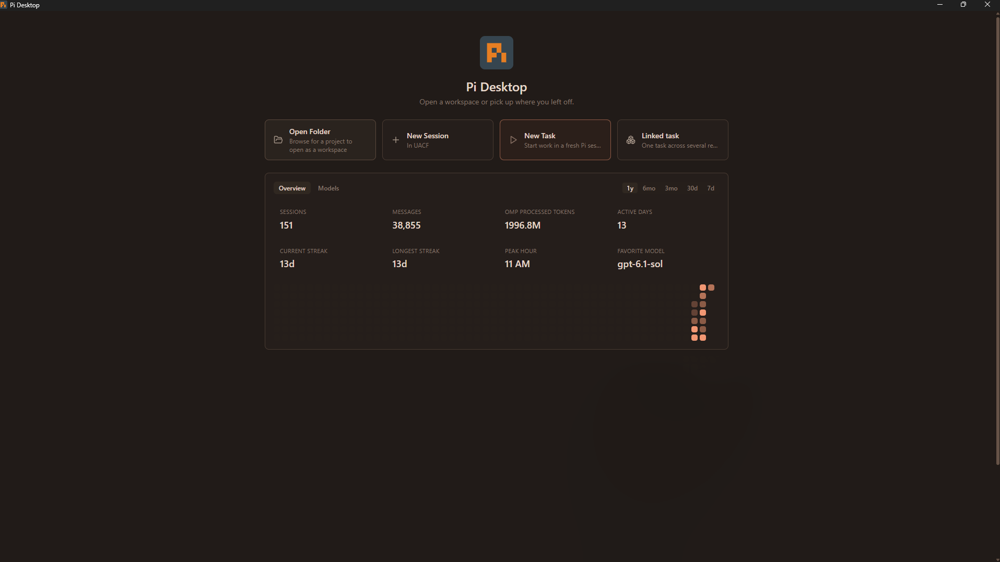
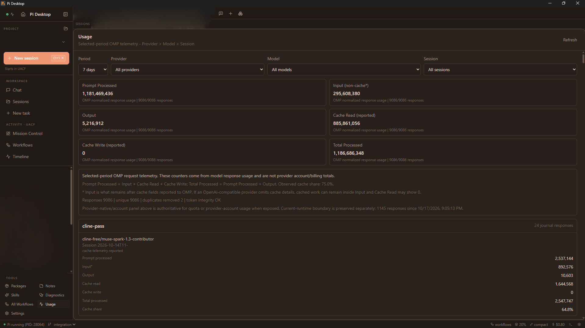

# Pi Desktop Mod

[](https://github.com/Tibetan777/pi-desktop-mod/actions/workflows/v15-windows.yml)
[](https://github.com/FaqFirebase/pi-desktop)
[](LICENSE)

An **unofficial community mod/fork** of [FaqFirebase/pi-desktop](https://github.com/FaqFirebase/pi-desktop).

This repository keeps the upstream Pi Desktop application and adds the tested V15.1 public modification layer used for OMP/provider reliability, model-capability handling, usage diagnostics, session/UI improvements, and a Windows release path.

The application is still called **Pi Desktop**. The repository is named **Pi Desktop Mod** so it cannot be confused with the upstream project.

> **Current public build:** V15.1 (`0.2.0-alpha.v15.1`) for Windows x64. This V15 overlay is verified and released for Windows only.

## Screenshots

These are the user-provided privacy-edited full-frame screenshots of the actual V15 mod UI. They are published byte-for-byte as supplied, with no additional cropping or image processing in this repository.



### Usage diagnostics



## What you get after installing

The public build is intentionally **OMP-first**, while keeping provider credentials and account configuration private to each user.

| Setting / component | Public V15 behavior |
| --- | --- |
| Agent runtime | **OMP** is the default runtime selection. |
| OMP executable | Pi Desktop looks for `omp` / `omp.exe` using its normal OMP detection. OMP itself is **not bundled** inside the Pi Desktop installer. |
| Thinking level | Defaults to **low**; model capability checks prevent unsupported effort levels from being invented. |
| Provider | **Not preset.** You authenticate and configure your own providers. |
| Model | **Not preset.** The model list comes from your OMP/provider configuration. |
| Permission mode | Keeps the safer upstream-style **ask-edits** default instead of copying the maintainer's trusted local-machine permission setting. |
| Theme | Uses the portable **system** theme; private/local themes are not copied. |
| Voice | Uses Pi Desktop's portable voice workflow. Maintainer-local model files and machine-specific speech acceleration are not included. |
| Session behavior | Resume-last-session, home launch behavior, thinking display, auto-scroll, and the V15 session/UI improvements remain enabled. |
| Usage page | Includes selected-period provider → model → session diagnostics and separates local OMP telemetry from provider-native quota/billing data. |

### OMP prerequisite

The mod selects OMP by default, but does not silently install or bundle the OMP executable. Install OMP first if it is not already available:

```powershell
bun install -g @oh-my-pi/pi-coding-agent
omp --version
```

Then open Pi Desktop. In **Settings → Agent Configuration → Agent Installation**, OMP should be detected/selected. If it is installed in a non-standard location, select its executable or install directory there.

After that, configure/authenticate whichever providers you want to use. No maintainer provider, account, model, token, cookie, or OAuth state is included.

## What this mod adds

| Area | V15 modification |
| --- | --- |
| OMP-first defaults | New installs default to OMP runtime selection and low thinking effort, without copying provider/model credentials. |
| OMP model picker | Recovers from the OMP v1 transport-size failure by negotiating protocol v2 and retrying model discovery once when that exact transport error occurs. |
| Thinking / effort levels | Uses OMP/provider-advertised capabilities instead of inventing unsupported effort levels. |
| Usage diagnostics | Separates **local OMP request/journal telemetry** from provider-native account/quota/billing data. Local counters are never presented as provider billing totals. |
| Usage navigation | Adds provider → model → session filtering and selected-period diagnostics. |
| Session/UI/runtime | Carries the accepted V15 session, history, UI, usage, and runtime improvements from the maintained mod snapshot. |
| Voice | Keeps the portable voice workflow while excluding machine-specific local speech models/paths. |
| Windows release | Reproducible Windows x64 CI producing NSIS installer and portable EXE builds. |
| Updates | Mod update checks target this fork's GitHub Releases. |

For implementation details, see [V15_MOD.md](V15_MOD.md).

## Download

Use the current Windows V15.1 prerelease from [GitHub Releases](https://github.com/Tibetan777/pi-desktop-mod/releases).

The Windows release provides:

- an NSIS setup installer — recommended for normal installation;
- a portable EXE.

The binaries are currently not code-signed, so Windows SmartScreen may warn on first launch.

## How V15 is applied

The mod is maintained as a deterministic post-build overlay in `patches/v15/`.

`npm run build`:

1. runs the normal upstream Electron/Vite build;
2. verifies the expected clean generated bundle hashes;
3. applies the reviewed V15 patches;
4. verifies the expected V15 output hashes.

If the generated upstream bundle does not match the expected base, the overlay **fails closed** rather than patching unknown output.

## Build status and platform support

The public V15 release is currently **Windows x64 only**.

Linux and macOS remain upstream-supported platforms, but this V15 overlay is not claimed as cross-platform. Generated renderer output differs by platform, so the mod CI only publishes the platform that has been verified.

The `V15 Windows Build` workflow verifies:

- lint;
- unit tests;
- TypeScript type-check;
- deterministic V15 overlay;
- Windows NSIS + portable packaging.

## Privacy / publication boundary

This public fork intentionally excludes maintainer-specific runtime data, including:

- Pi/OMP sessions and conversation history;
- activity/usage stores and local journal data;
- provider account state;
- cookies and Electron/browser profiles;
- OAuth access/refresh tokens;
- API keys, GitHub tokens, and private keys;
- local recovery archives;
- local model files and private machine-specific model paths;
- the maintainer's private native speech acceleration setup;
- private workspace/project identifiers from documentation screenshots.

The public screenshots are the maintainer-sanitized full images and are published without additional cropping. Credentials are never intentionally included.

## Build from source

```powershell
git clone https://github.com/Tibetan777/pi-desktop-mod.git
cd pi-desktop-mod
npm ci
npm run lint
npm run typecheck
npm run build
npx --no-install electron-builder --win nsis portable --x64 --publish never
```

## Upstream

Original project: **[FaqFirebase/pi-desktop](https://github.com/FaqFirebase/pi-desktop)**

Pi Desktop is a free, open-source Electron GUI for Pi and oh-my-pi coding agents. This repository is a community fork that adds the modifications documented above.

For the original project, upstream documentation, and upstream cross-platform releases, use the upstream repository.

## License

Apache-2.0, inherited from the upstream project. Upstream copyright and license notices are retained.
